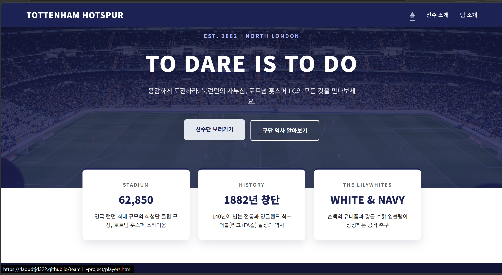

# team11-project
# 토트넘 홋스퍼 FC 소개 홈페이지 (2026/27 시즌)

## 프로젝트 소개
잉글랜드 프리미어리그(EPL) 구단 **토트넘 홋스퍼 FC(Tottenham Hotspur FC)**의 구단 역사와 2026/27 시즌 1군 선수단을 소개하는 웹사이트입니다.

## 주요 기능
- 첫 페이지(`index.html`)를 통한 구단 슬로건 및 핵심 요약 정보 제공
- 2026/27 시즌 감독 및 포지션별(FW, MF, DF, GK) 선수 프로필 카드 보기(`players.html`)
- 구단 창단 역사 타임라인 및 토트넘 홋스퍼 스타디움 소개(`about.html`)

## 실행 화면

## 실행 방법
https://rladudtjd322.github.io/team11-project/

## 사용한 오픈소스
- [Google Fonts - Noto Sans KR & Montserrat](https://fonts.google.com/)
- [GitHub Pages](https://pages.github.com/)

## 팀원 및 역할
| 이름 | 역할 |
|---|---|
| [김영성] | 2번 선수 소개 페이지 및 전체 공통 디자인 (`players.html`, `common.css`, `players.css`) |
| [김지훈] | 1번 첫 페이지 및 3번 팀 소개 페이지 (`index.html`, `about.html`, `main.css`, `about.css`) |